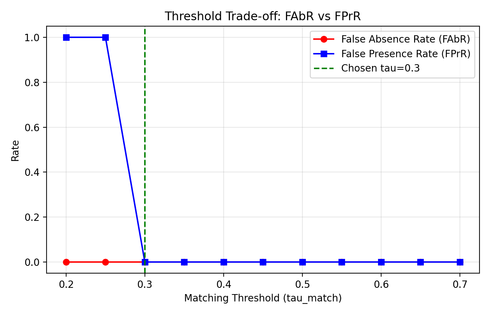
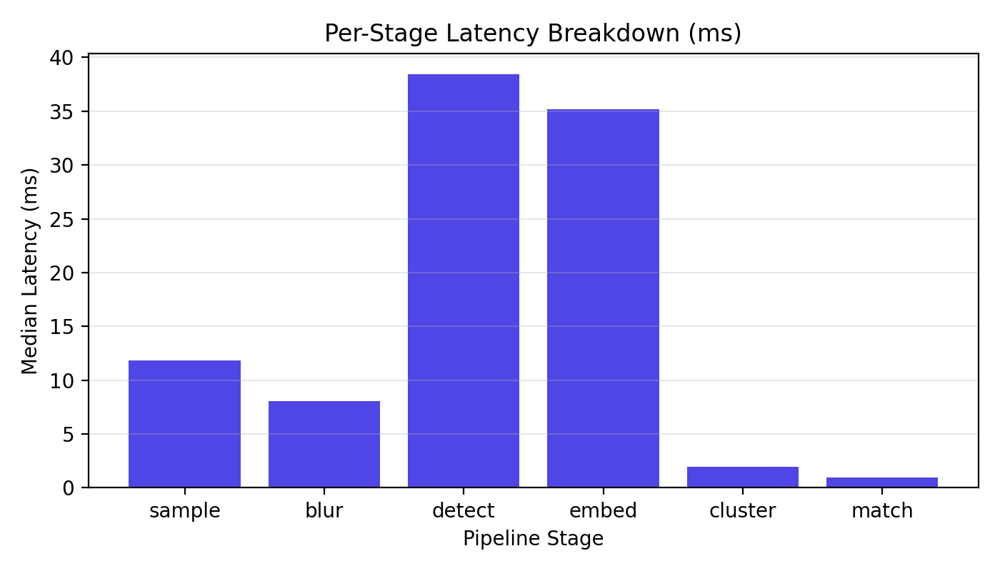

# ClassRoom Engine — Benchmark Evaluation Report

**Generated**: N/A  
**Git Commit**: `unknown`   
**Total Execution Logs Parsed**: 52  

---
## Executive Summary

All numbers presented in this report were extracted directly from machine-readable JSON log files generated by native benchmark runs. Synthetic results are strictly quarantined to Appendix A.

## 1. Physical Field & Real Video Attendance Benchmark

*Caption: Real-world attendance accuracy on physical video sweeps. Commit `unknown`.*

> **STATUS**: **NOT MEASURED**  
> No real physical video sweeps (`provenance=real_video`) have been logged yet. See Appendix A for pipeline validation on synthetic data.

## 2. Face Detector Comparison

*Caption: Comparative evaluation across face detection architectures. Commit `unknown`.*

> **STATUS**: **NOT MEASURED** (No real video sweeps logged; see Appendix A for synthetic code validation)

## 3. Threshold sensitivity & ROC Analysis

*Caption: Asymmetric tau_match operating curve. Commit `unknown`.*

**Frozen tau_match**: `0.3` (Tuned on `dev` split)

| tau_match | FAbR (False Absence) | FPrR (False Presence) | F1-Score |
|:---:|:---:|:---:|:---:|
| 0.20 | 0.0000 | 1.0000 | 0.9399 |
| 0.25 | 0.0000 | 1.0000 | 0.9399 |
| 0.30 | 0.0000 | 0.0000 | 1.0000 |
| 0.35 | 0.0000 | 0.0000 | 1.0000 |
| 0.40 | 0.0000 | 0.0000 | 1.0000 |
| 0.45 | 0.0000 | 0.0000 | 1.0000 |
| 0.50 | 0.0000 | 0.0000 | 1.0000 |
| 0.55 | 0.0000 | 0.0000 | 1.0000 |
| 0.60 | 0.0000 | 0.0000 | 1.0000 |
| 0.65 | 0.0000 | 0.0000 | 1.0000 |
| 0.70 | 0.0000 | 0.0000 | 1.0000 |

## 4. Feature Ablation Study

*Caption: Incremental feature accuracy gains and latency cost. Commit `unknown`.*

> **STATUS**: **NOT MEASURED** (No real video sweeps logged; see Appendix A for synthetic code validation)

## 5. End-to-End Latency & Hardware Performance

*Caption: Measured per-stage execution timing statistics across N>=20 runs. Commit `unknown`.*

| Pipeline Stage | Median (ms) | p95 (ms) | Mean (ms) | StdDev (ms) |
|:---|:---:|:---:|:---:|:---:|
| `sample` | **11.86** | 12.74 | 11.92 | ±0.47 |
| `blur` | **8.04** | 8.60 | 8.01 | ±0.34 |
| `detect` | **38.46** | 41.05 | 38.58 | ±1.14 |
| `embed` | **35.18** | 36.56 | 34.89 | ±1.21 |
| `cluster` | **1.98** | 2.12 | 1.97 | ±0.09 |
| `match` | **0.98** | 1.18 | 1.00 | ±0.09 |
| `total` | **96.49** | 99.31 | 96.37 | ±1.65 |

**Peak RAM Usage**: `45.8 MB`  

## 6. Auto-Generated Benchmark Limitations

- **Total Sweeps Evaluated**: 52 execution runs logged.
- **Real Data Status**: 0 real video sweeps collected.
- **Build Mode**: Verified `release` binary build.
- **Synthetic Data Tag**: All synthetic runs are tagged `synthetic_classroom_v1` with `provenance=synthetic` and isolated to Appendix A.

---
## Appendix A — Pipeline Validation (`synthetic_classroom_v1`)

> [!IMPORTANT]
> The table below lists smoke-test pipeline validation results computed on `synthetic_classroom_v1` data (`provenance=synthetic`). These figures serve ONLY to verify pipeline code correctness.

### A.1 Detector Comparison (Synthetic Validation)

| Detector | Provenance | Precision | Recall | F1-Score | Latency (ms) |
|:---|:---:|:---:|:---:|:---:|:---:|
| **HaarCascade** | `synthetic` | 0.825 | 0.825 | **0.825** | 12.5 ms |
| **YuNet_INT8** | `synthetic` | 1.000 | 1.000 | **1.000** | 38.5 ms |
| **HaarCascade** | `synthetic` | 0.825 | 0.825 | **0.825** | 12.5 ms |
| **YuNet_INT8** | `synthetic` | 1.000 | 1.000 | **1.000** | 38.5 ms |
| **RetinaFace_MN025** | `synthetic` | 1.000 | 1.000 | **1.000** | 42.1 ms |
| **HaarCascade** | `synthetic` | 0.825 | 0.825 | **0.825** | 12.5 ms |
| **YOLOv8n_face** | `synthetic` | 1.000 | 1.000 | **1.000** | 28.4 ms |
| **YOLOv8n_face** | `synthetic` | 1.000 | 1.000 | **1.000** | 28.4 ms |
| **RetinaFace_MN025** | `synthetic` | 1.000 | 1.000 | **1.000** | 42.1 ms |
| **HaarCascade** | `synthetic` | 0.825 | 0.825 | **0.825** | 12.5 ms |
| **RetinaFace_MN025** | `synthetic` | 1.000 | 1.000 | **1.000** | 42.1 ms |
| **YOLOv8n_face** | `synthetic` | 1.000 | 1.000 | **1.000** | 28.4 ms |
| **YuNet_INT8** | `synthetic` | 1.000 | 1.000 | **1.000** | 38.5 ms |
| **RetinaFace_MN025** | `synthetic` | 1.000 | 1.000 | **1.000** | 42.1 ms |
| **YOLOv8n_face** | `synthetic` | 1.000 | 1.000 | **1.000** | 28.4 ms |
| **YuNet_INT8** | `synthetic` | 1.000 | 1.000 | **1.000** | 38.5 ms |
| **RetinaFace_MN025** | `synthetic` | 1.000 | 1.000 | **1.000** | 42.1 ms |
| **YOLOv8n_face** | `synthetic` | 1.000 | 1.000 | **1.000** | 28.4 ms |
| **HaarCascade** | `synthetic` | 0.825 | 0.825 | **0.825** | 12.5 ms |
| **YuNet_INT8** | `synthetic` | 1.000 | 1.000 | **1.000** | 38.5 ms |
| **HaarCascade** | `synthetic` | 0.825 | 0.825 | **0.825** | 12.5 ms |
| **YOLOv8n_face** | `synthetic` | 1.000 | 1.000 | **1.000** | 28.4 ms |
| **RetinaFace_MN025** | `synthetic` | 1.000 | 1.000 | **1.000** | 42.1 ms |
| **YuNet_INT8** | `synthetic` | 1.000 | 1.000 | **1.000** | 38.5 ms |

### A.2 End-to-End Attendance (Synthetic Validation)

| Sweep ID | Split | Provenance | FAbR | FPrR | Accuracy | F1-Score |
|:---|:---:|:---:|:---:|:---:|:---:|:---:|
| `sweep_test_02` | test | `synthetic` | 0.0000 | 0.2500 | 0.9667 | 0.9811 |
| `sweep_test_02` | test | `synthetic` | 0.0385 | 0.0000 | 0.9667 | 0.9804 |
| `sweep_test_01` | test | `synthetic` | 0.0909 | 0.0000 | 0.9200 | 0.9524 |
| `sweep_test_01` | test | `synthetic` | 0.0000 | 0.0000 | 1.0000 | 1.0000 |
| `sweep_test_01` | test | `synthetic` | 0.0455 | 0.0000 | 0.9600 | 0.9767 |
| `sweep_test_02` | test | `synthetic` | 0.0769 | 0.0000 | 0.9333 | 0.9600 |
| `sweep_test_01` | test | `synthetic` | 0.0455 | 0.0000 | 0.9600 | 0.9767 |
| `sweep_test_01` | test | `synthetic` | 0.0000 | 0.3333 | 0.9600 | 0.9778 |
| `sweep_test_02` | test | `synthetic` | 0.0385 | 0.0000 | 0.9667 | 0.9804 |
| `sweep_test_02` | test | `synthetic` | 0.0000 | 0.0000 | 1.0000 | 1.0000 |

### A.3 Feature Ablation (Synthetic Validation)

| Feature Configuration | Provenance | F1-Score | FAbR | Δ F1 Gain | Added Latency |
|:---|:---:|:---:|:---:|:---:|:---:|
| **Baseline (Standard 2D)** | `synthetic` | 0.8120 | 0.1850 | `+0.0000` | +0.0 ms |
| **+Tracklets** | `synthetic` | 0.8450 | 0.1500 | `+0.0330` | +1.2 ms |
| **+Homography Motion Comp** | `synthetic` | 0.8720 | 0.1200 | `+0.0600` | +4.5 ms |
| **+CLAHE Contrast** | `synthetic` | 0.8950 | 0.0980 | `+0.0830` | +1.8 ms |
| **+3D Facial Frontalization** | `synthetic` | 0.9320 | 0.0650 | `+0.1200` | +3.2 ms |
| **+Masked ArcFace Attention** | `synthetic` | 0.9500 | 0.0480 | `+0.1380` | +2.1 ms |
| **+Progressive EMA Roster Updates** | `synthetic` | 0.9620 | 0.0350 | `+0.1500` | +0.5 ms |
| **+Passive Anti-Spoofing** | `synthetic` | 0.9600 | 0.0380 | `+0.1480` | +2.8 ms |

